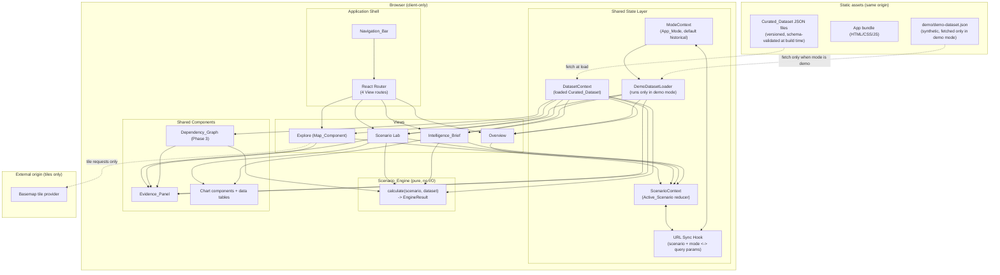
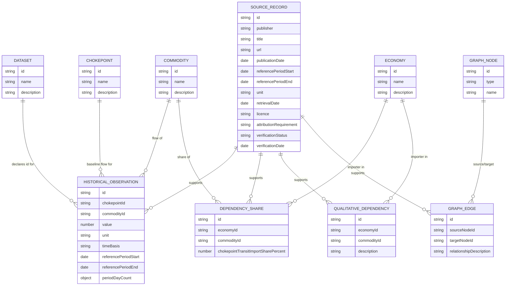

# Design Document: RIPPLE Hormuz Intelligence Terminal

## Overview

RIPPLE is a client-side single-page application (SPA) that lets an analyst explore the Strait of Hormuz, set a hypothetical disruption scenario, and see transparent, deterministic, source-backed calculations for crude oil and LNG separately. The MVP has no backend: it is a statically built React + TypeScript bundle, a bundled versioned dataset, and a basemap tile fetch, deployable to any static host.

The design follows the approved build order (Requirement 20): Phase 1 delivers the application shell, Overview, and Scenario Lab foundation; Phase 2 completes the four-View MVP journey (adds Explore, Evidence Panel, Intelligence Brief); Phase 3 adds the Dependency Graph, visual polish, responsive layout, and measured performance; Phase 4 is stretch. This document is organized so that Phase 1–2 concerns (shell, scenario state, engine, map, evidence, brief) are described before Phase 3 concerns (dependency graph, extended visuals).

Four principles recur through every section, matching the Continuous_Requirements (4, 12, 14, 18):
- Every number has exactly one Class_Label (Historical, Hypothetical, Calculated; in demo mode "Illustrative" replaces "Historical" on synthetic inputs) and traces to a Source_Record or to a named scenario input (or, in demo mode, to a Synthetic_Record).
- The Scenario_Engine is a pure, deterministic function with no network calls, no randomness, and no knowledge of Hormuz/oil/LNG in its interface.
- Nothing is fabricated: missing data produces an explicit "unavailable" / "not calculable" state, never a substituted or interpolated value.
- Mode is a user choice (Requirement 22). Illustrative demo data lives in a separate dataset and a separate view-model branch, carries a fourth label ("Illustrative"), and never enters the Historical path. Historical mode is the default and never loads, displays, or calculates with demo values.

No commodity figures, country shares, or source values are included in this design for the Curated_Dataset — it is populated later from verified Candidate_Sources (IEA, US EIA, UNCTAD) following the schema defined here. The only authored numbers in the design are the synthetic, fictional, round demo values in "Data Models, Demo_Dataset", which are not drawn from any source.

## Architecture

### Technology choices

| Concern | Choice | Rationale | Rejected alternative |
|---|---|---|---|
| Build tool | Vite | Fast dev server, zero-config static build, native TS/React support, small config surface for a solo dev | Create React App (unmaintained), Next.js (brings a server/runtime model the project explicitly doesn't need) |
| UI framework | React 18 + TypeScript | Required by Requirement 16.1 | — |
| Routing | React Router (data router, `createBrowserRouter`) | Gives distinct URL paths per View (Req 1.2) with `replace` navigation for in-place URL sync (Req 1.5), minimal code | Hash-based custom router (more code, worse SEO/bookmarking); TanStack Router (more powerful than needed) |
| Shared scenario state | React Context + `useReducer`, with the reducer as the single source of truth, synced to the URL via a router-aware hook | Scenario state is small (3 fields + derived view), updated infrequently, and read by many components. Context/reducer avoids adding a state library dependency and keeps the reducer pure and unit-testable in isolation from React | Redux/Zustand (extra dependency for a state shape this small); prop drilling (breaks "shared across four Views" requirement) |
| Map | MapLibre GL JS | Required by Requirement 16.1; open-source, no API key, vector-tile capable | Leaflet (weaker vector styling), Mapbox GL JS (proprietary license/token) |
| Basemap tiles | Provider chosen during implementation against the selection criteria in "Basemap provider selection and map completion gate"; the basemap is a configurable style URL plus attribution string, with the WebGL/tile-failure fallback of Requirement 3.9 always available. The map is not considered complete until usage terms, attribution, access limits and availability are verified and recorded | Avoids a hard dependency on one provider's uptime or licensing; no public demonstration tile server is assumed to permit production use | Self-hosting tiles (too heavy for a static deploy); hard-coding one provider |
| Charts | Lightweight hand-rolled SVG bar/line chart components (confirmed decision; no charting library) with a mandatory parallel `<table>` data view for every chart (Req 8.6) | Keeps bundle small; the text-alternative requirement means the chart is never the only way to read the data, which also lowers the bar for the charting library itself (it need not be independently a11y-perfect) | Canvas-based charting (harder to make accessible, no DOM nodes for axe to inspect) |
| Dependency graph rendering | A fixed-layout SVG node/edge renderer built by hand (confirmed decision; no physics or graph library), with a parallel accessible text-list view as the primary a11y interface (Req 9.9) | The MVP graph is small (one chokepoint, two commodities, a handful of industries/economies — "no larger network is required" per Req 9.1), so a full graph library (Cytoscape, D3-force, react-flow) is unjustified weight; a static/fixed layout keyboard-nav list is simpler to make correctly keyboard-operable (Req 9.8) than retrofitting a physics library | Cytoscape.js / react-flow (heavier, harder to make keyboard-accessible out of the box) |
| Schema validation | Zod | Single dependency defines both the TypeScript types (via `z.infer`) and the runtime validator used at build time and at dataset-load time, satisfying Req 4.11/4.12/4.3/4.14/9.3 with one source of truth | JSON Schema + ajv (two artifacts to keep in sync: schema and types) |
| Unit tests + property-based tests | Vitest + fast-check | Vitest shares Vite's config and is fast; fast-check is the standard JS property-based testing library (do not hand-roll a PBT runner, per workflow constraint) | Jest (slower, separate config from Vite) |
| E2E + accessibility | Playwright + `@axe-core/playwright` | Playwright drives real browsers for keyboard/focus testing and WebGL fallback testing; axe integrates directly into Playwright runs for automated WCAG scans (Req 14.1, 18.6) | Cypress (weaker multi-tab/keyboard support needed for Req 10.6) |
| Deployment | Primary: Netlify or Cloudflare Pages with an SPA fallback rewrite to `index.html`. Fallback: GitHub Pages with a `404.html` copy of `index.html`. See "Static Deployment and Routing" | Satisfies "no backend, static files, same-origin dataset" (Req 16.2) and keeps path-based View URLs (Req 1.2) | HashRouter (works on any host, but changes URL shape and makes the not-found path rule of Req 1.7 less natural) |
| Stale threshold | `STALE_THRESHOLD_MONTHS = 12`, a single configurable constant. The user has confirmed 12 months | Req 12.9 | — |

### High-level architecture



No application code runs on a server. The only runtime network traffic is the same-origin dataset fetch and basemap tile requests (Req 16.3).

### Data flow summary

1. **App load**: the dataset loader fetches the bundled Curated_Dataset JSON, validates it with the Zod schema (defense in depth — the build already validated it), and populates `DatasetContext`. A failed fetch/validation surfaces the per-file error state from Req 16.7 without blocking the rest of the shell.
2. **URL → scenario**: on initial load, the URL sync hook reads query parameters, runs them through `Scenario_Input_Validation`, and initializes the reducer state — invalid parameters are replaced with defaults and a corrective notice is queued (Req 1.4, 6.10).
3. **Scenario change → engine → views**: any control that dispatches a scenario action updates the reducer; the URL sync hook mirrors the new state into the URL via `history.replaceState`-style navigation (no new history entry, Req 1.5); any View subscribed to `ScenarioContext` re-renders; Scenario Lab, Intelligence Brief, and the Dependency Graph re-run `Scenario_Engine.calculate` with the new scenario and the (unchanged) dataset.
4. **View switch**: the router changes which View is mounted; `ScenarioContext` and `ModeContext` are providers above the router outlet, so no scenario or mode state is lost (Req 1.3).
5. **Mode**: the URL parameter `mode` is decoded with the scenario parameters. `historical` (or absent) leaves the demo file untouched. `demo` makes `DemoDatasetLoader` fetch and validate `demo/demo-dataset.json`. Nothing else requests that file (Req 22.1, 22.2).

### Illustrative Demo Mode (Requirement 22)

**Approach.** A user-selected `AppMode` (`'historical'` default, or `'demo'`) chooses the data source. Demo mode reads a separate, strictly typed synthetic file, `public/data/demo/demo-dataset.json`, shipped in the production deployment. A mode-aware view-model maps either source into the existing `EngineInput`, so `calculate()` is unchanged and never sees the mode. Historical mode is unchanged: missing baselines still show "Source unavailable", "not calculable" and empty exposure lists, and nothing falls back from Historical to Demo.

| Decision | Choice | Rejected alternative |
|---|---|---|
| Label scheme | A fourth Class_Label, "Illustrative", replaces "Historical" on synthetic baseline flow and share inputs. "Hypothetical" and "Calculated" keep their meaning. In demo mode every "Hypothetical" or "Calculated" figure also carries the non-class Demo_Marker ("Illustrative demo"). | A second stacked Class_Label on outputs would break Req 12.1 ("exactly one Class_Label"). Without a marker a synthetic baseline would read as "Historical". |
| Where the mode lives | A separate `ModeProvider`. `ActiveScenario`, its reducer, and `reset` are unchanged. | A `mode` field on `ActiveScenario` would change `EngineInput.scenario`, the reducer tests, and what Reset does. |
| Persistence | The URL only (`mode=demo`; absent means `historical`). No localStorage, sessionStorage, or cookie. | A saved preference would become a hidden default and could open a Historical link in demo mode. |
| Demo data location | One file fetched only in demo mode. | A bundled TypeScript module would ship synthetic numbers in every Historical page load. Reusing `tests/fixtures` would break the test-only rule for fixtures. |
| Schema separation | `DemoDatasetSchema` is a separate strict schema (`synthetic: z.literal(true)`, no source, status, or date fields). `CuratedDatasetSchema` is untouched. | Reusing `HistoricalObservationSchema` with a flag would let one typo make synthetic data parse as historical. |
| Reset | Does not change the mode (Req 22.3). | Reset only restores 25 / 7 / `both` (Req 5.7). |
| Reference statement | Replaced by the Demo_Reference_Statement in demo mode. | The original refers to a "stated reference period" that demo data does not have. |
| Explore map | No demo branch. The map, its layers, detail cards, and Source_Records stay Curated_Dataset only. Demo mode adds the banner and the mode toggle behaviour only. | A demo map would need invented geography or dependency claims about real places. |
| Demo view branches | Only Overview, Scenario Lab, Evidence_Panel, and Intelligence_Brief (plus the banner on all four Views). | Branching every View, including the map, adds cost with no judging value. |

**Structure.**
- `ModeProvider` sits above `ScenarioProvider` and `DatasetProvider`. Its state is `AppMode`, default `'historical'`. Its reducer has one action, `setMode`. The scenario actions (`setMagnitude`, `setDuration`, `setScope`, `reset`) never touch it, and a View change never touches it.
- `DemoDatasetLoader` fetches `demo/demo-dataset.json` only after the mode becomes `demo` (the URL is built from `import.meta.env.BASE_URL`), and validates it with `DemoDatasetSchema`. On failure it exposes `{ status: 'error', file: 'demo/demo-dataset.json' }`. The loader is never invoked in Historical mode, so a Historical session makes zero requests to `/data/demo/`.
- `selectViewModel({ mode, dataset, demo, scenario, analysisDate })` returns a discriminated union `{ mode: 'historical' } & HistoricalViewModel | { mode: 'demo' } & DemoViewModel`. The demo branch maps `DemoFlow` to `FlowInput` and `DemoDependencyShare` to `DependencyShareInput` through the fixed table `{ 'demo-oil': 'oil', 'demo-lng': 'lng' }`, then calls the unchanged `calculate()`.
- The types make mixing impossible. `HistoricalViewModel` labels are typed `ClassLabel` (no "Illustrative"). `DemoViewModel` labels are typed `'Illustrative' | 'Hypothetical' | 'Calculated'` (no "Historical"). `ILLUSTRATIVE_LABEL` is a separate constant, and `CLASS_LABELS` is not modified.
- If the demo data is not ready (loading or failed), the demo view-model carries `demoStatus: 'loading' | 'error'` and every demo figure renders "Demo data unavailable". It never reads the Curated_Dataset for a baseline or share (Req 22.12).

## Components and Interfaces

### Component tree (Phase 1–2 first, Phase 3 additions marked)

```
App
├── ModeProvider (Context + reducer, App_Mode)
├── ScenarioProvider (Context + reducer)
├── DatasetProvider (Context, loads + validates dataset once)
├── DemoDatasetProvider (loads + validates the Demo_Dataset, demo mode only)
├── AppShell
│   ├── SkipLink
│   ├── Header (Analysis_Date, Reference_Statement or Demo_Reference_Statement, ModeToggle)
│   ├── ModeBanner (demo mode only; inside the header landmark)
│   ├── NavigationBar (aria-current routing)
│   ├── <RouterOutlet>
│   │     ├── OverviewView
│   │     ├── ExploreView
│   │     │     ├── MapComponent (MapLibre)
│   │     │     ├── LayerToggles
│   │     │     ├── FeatureDetailCard
│   │     │     └── MapTextAlternative
│   │     ├── ScenarioLabView
│   │     │     ├── ScenarioControls (magnitude, duration, scope, reset)
│   │     │     ├── CommodityResultPanel (one per commodity)
│   │     │     │     ├── FlowChart + data table
│   │     │     │     └── ExposureChart + data table (if any Quantified_Economy)
│   │     │     └── DependencyGraphSection (Phase 3)
│   │     └── IntelligenceBriefView
│   ├── EvidencePanel (drawer on mobile, side panel on desktop)
│   └── LiveRegion (polite announcements: view change, scenario result, errors)
└── Footer (dataset version, Build_Date, licence/attribution roll-up)
```

### Key module interfaces (TypeScript sketches — signatures only, no data)

```ts
// Scenario domain types
type CommodityId = 'oil' | 'lng';
type CommodityScope = CommodityId | 'both';

interface ActiveScenario {
  magnitudePercent: number; // integer 0-100
  durationDays: number;  // integer 1-365
  commodityScope: CommodityScope;
}

// Scenario_Input_Validation — one canonical module used by controls, URL parsing, and tests
interface ValidationResult<T> {
  ok: boolean;
  value?: T;           // present when ok
  errorMessage?: string; // "<control name> must be a whole number from <min> to <max>."
}

function validateIntegerInRange(
  raw: string,
  min: number,
  max: number,
  controlLabel: string
): ValidationResult<number>;

function validateCommodityScope(raw: string): ValidationResult<CommodityScope>;

// URL <-> ActiveScenario (Req 1.4, 1.5, 6.10, 18.3)
function encodeScenarioToSearchParams(scenario: ActiveScenario): URLSearchParams;
function decodeScenarioFromSearchParams(
  params: URLSearchParams,
  defaults: ActiveScenario
): { scenario: ActiveScenario; corrections: string[] }; // corrections lists each replaced field
```

```ts
// App mode (Req 22). ActiveScenario is unchanged and does not contain the mode.
type AppMode = 'historical' | 'demo';
interface AppState { scenario: ActiveScenario; mode: AppMode }

function validateAppMode(raw: string): ValidationResult<AppMode>; // exact, case-sensitive 'historical' | 'demo'

// Added in task 4.20. The scenario functions above keep their signatures and are called internally.
function encodeAppStateToSearchParams(s: AppState): URLSearchParams; // m, d, c, then mode=demo only when mode is 'demo'
function decodeAppStateFromSearchParams(
  params: URLSearchParams,
  defaults: AppState
): { state: AppState; corrections: string[] }; // an invalid mode becomes 'historical' with one correction naming `mode`
```

The URL parameter names stay `m`, `d`, `c`, and `mode`. `historical` is the default and is omitted when encoding. Navigation links read the mode from state, not from `location.search`.

```ts
// Scenario_Engine — pure, no Hormuz/oil/LNG-specific identifiers in the interface (Req 17.3)
interface FlowInput {
  chokepointId: string;
  commodityId: string;
  baselineTransitFlow: number;
  unit: string;
  timeBasis: 'per-day' | 'per-year';
  periodDayCount?: number; // required iff timeBasis === 'per-year'
}

interface DependencyShareInput {
  chokepointId: string;
  commodityId: string;
  economyId: string;
  economyName: string;
  chokepointTransitImportSharePercent: number; // 0-100, verified share of the economy's imports of the commodity that transit the chokepoint named by chokepointId
}

interface EngineInput {
  scenario: ActiveScenario;
  flows: FlowInput[];              // one per commodity in scope
  dependencyShares: DependencyShareInput[]; // Quantified_Economy records only
}

type CalculatedValue =
  | { status: 'calculated'; value: number; unit: string }
  | { status: 'not-calculable'; missingInputs: string[] };

interface CommodityFlowResult {
  commodityId: string;
  unit: string;
  baselineDailyFlow: CalculatedValue;      // Class_Label "Calculated" (or passthrough per 7.2)
  periodDayCountUsed?: { value: number; referenceYear?: number; isLeapYear?: boolean };
  dailyReducedFlow: CalculatedValue;
  cumulativeReducedFlow: CalculatedValue;
}

interface ExposureResult {
  economyId: string;
  economyName: string;
  commodityId: string;
  scenarioExposureIndex: CalculatedValue; // percent
}

interface EngineResult {
  perCommodity: Record<string, CommodityFlowResult>; // never a combined/summed entry
  exposureByCommodity: Record<string, ExposureResult[]>; // ranked, truncated, see Property 14
}

function calculate(input: EngineInput): EngineResult; // pure, deterministic, no I/O, no RNG
```

```ts
// Dataset schema (Zod) — shape only, values populated later from verified sources
const SourceRecordSchema = z.object({
  id: z.string(),
  publisher: z.string(),
  title: z.string(),
  url: z.string().url(),
  publicationDate: z.string().date(),
  referencePeriodStart: z.string().date(),
  referencePeriodEnd: z.string().date(),
  unit: z.string(),
  retrievalDate: z.string().date(),
  licence: z.string(),
  attributionRequirement: z.string(),
  verificationStatus: z.enum(['verified', 'unverified']),
  verificationDate: z.string().date(),
});

const HistoricalObservationSchema = z.object({
  id: z.string(),
  datasetId: z.string().min(1),       // DatasetId (branded in the real schema, see below)
  chokepointId: z.string(),           // ChokepointId
  commodityId: z.string(),            // CommodityId
  verificationStatus: z.enum(['verified', 'unverified']), // build requires 'verified'
  value: z.number(),
  unit: z.string(),
  timeBasis: z.enum(['per-day', 'per-year']),
  referencePeriodStart: z.string().date(),
  referencePeriodEnd: z.string().date(),
  periodDayCount: z.object({
    days: z.number().int().safe().min(1),  // positive integer, no upper limit; never inferred or defaulted
    referenceYear: z.number().int().optional(), // when present, days must be 365 or 366 matching leap-year status
    isLeapYear: z.boolean().optional(),
  }).strict().optional(), // required when timeBasis === 'per-year' (enforced by the implemented schema)
  sourceRecordIds: z.array(z.string()).min(1),
});

// Branded ID types: one consistent identifier type per entity, so a CommodityId can never be passed where a SourceRecordId is expected
const DatasetId = z.string().min(1).brand<'DatasetId'>();
const ChokepointId = z.string().min(1).brand<'ChokepointId'>();
const CommodityId = z.string().min(1).brand<'CommodityId'>();
const EconomyId = z.string().min(1).brand<'EconomyId'>();
const SourceRecordId = z.string().min(1).brand<'SourceRecordId'>();

const VerificationStatus = z.enum(['verified', 'unverified']);
const ReferencePeriod = z.object({
  start: z.string().date(),
  end: z.string().date(),   // build check: end >= start
});

// Hormuz-transit (chokepoint-transit) import share for one economy and commodity. Numeric, verified, sourced.
const DependencyShareSchema = z.object({
  id: z.string().min(1),
  datasetId: DatasetId,
  chokepointId: ChokepointId,
  commodityId: CommodityId,
  economyId: EconomyId,
  chokepointTransitImportSharePercent: z.number().min(0).max(100),
  unit: z.literal('percent'),
  referencePeriod: ReferencePeriod,          // observation period of the share
  verificationStatus: VerificationStatus,    // build requires 'verified'
  sourceRecordIds: z.array(SourceRecordId).min(1),
});

// Qualitative dependency: words only. .strict() rejects any extra key, so a numeric field cannot be added.
const QualitativeDependencySchema = z.object({
  id: z.string().min(1),
  datasetId: DatasetId,
  chokepointId: ChokepointId,
  commodityId: CommodityId,
  economyId: EconomyId,
  description: z.string().min(1),
  referencePeriod: ReferencePeriod,
  verificationStatus: VerificationStatus,    // build requires 'verified'
  sourceRecordIds: z.array(SourceRecordId).min(1),
}).strict();

const GraphEdgeSchema = z.object({
  id: z.string(),
  sourceNodeId: z.string(),
  targetNodeId: z.string(),
  relationshipDescription: z.string(),
  sourceRecordIds: z.array(z.string()).min(1),
});

// Declaration records: the stable ids that every other record references. All strict.
// Commodity declarations carry no mandatory standard unit (each observation carries its own unit).
// Economy declarations carry no country code at this stage.
const DatasetDeclarationSchema = z.object({ id: DatasetId, name: z.string().min(1), description: z.string().min(1).optional() }).strict();
const ChokepointDeclarationSchema = z.object({ id: ChokepointId, name: z.string().min(1), description: z.string().min(1).optional() }).strict();
const CommodityDeclarationSchema = z.object({ id: CommodityId, name: z.string().min(1), description: z.string().min(1).optional() }).strict();
const EconomyDeclarationSchema = z.object({ id: EconomyId, name: z.string().min(1), description: z.string().min(1).optional() }).strict();

// All dataset record schemas above and below are strict: unknown keys are rejected.
const CuratedDatasetSchema = z.object({
  schemaVersion: z.string(),
  buildDate: z.string().date(),
  datasets: z.array(DatasetDeclarationSchema),       // required collection; may be empty
  chokepoints: z.array(ChokepointDeclarationSchema), // required collection; may be empty
  commodities: z.array(CommodityDeclarationSchema),  // required collection; may be empty
  economies: z.array(EconomyDeclarationSchema),      // required collection; may be empty
  sourceRecords: z.array(SourceRecordSchema),
  historicalObservations: z.array(HistoricalObservationSchema),
  dependencyShares: z.array(DependencyShareSchema),
  qualitativeDependencies: z.array(QualitativeDependencySchema),
  graphNodes: z.array(z.object({ id: z.string(), type: z.enum(['transport','commodity','industry','economy']), name: z.string() })),
  graphEdges: z.array(GraphEdgeSchema),
}).strict();
```

In the implemented `src/data/schema.ts` the schemas are written with `z.strictObject`, which has the same effect as `.strict()` shown in this sketch.

### Component responsibilities

| Component | Responsibility | Key requirements |
|---|---|---|
| `ScenarioProvider` | Owns the `ActiveScenario` reducer; exposes dispatch actions (`setMagnitude`, `setDuration`, `setScope`, `reset`); never touches the DOM or network | 1.3, 5.5, 5.7 |
| `ModeProvider` | Owns the `AppMode` reducer (`setMode` only), default `'historical'`; unaffected by scenario actions and View changes | 22.1, 22.3 |
| `DemoDatasetProvider` | Fetches and validates `demo/demo-dataset.json` only while the mode is `demo`; exposes `{ status: 'idle'|'loading'|'ready'|'error', demo, file }` | 22.2, 22.12 |
| `ModeToggle` | Header `<button>` whose visible text is its accessible name ("Switch to Illustrative demo mode" or "Return to Historical mode"); changes the mode and announces the Mode_Announcement through `LiveRegion` | 22.3, 22.4 |
| `ModeBanner` | Demo mode only. Inside `<header>` (no extra landmark), `role="region"` with an `aria-label`, sticky, dashed 2 px border, non-dismissible. Contains the Demo_Banner_Text and a "Return to Historical mode" button that sets the mode to `historical` and moves focus to `ModeToggle` | 22.4, 22.5 |
| URL sync hook | Two-way bridge between reducer and `useSearchParams`; on mount decodes + validates, on change encodes with `replace: true`. Carries the scenario and the mode through the 4.20 `AppState` codec | 1.4, 1.5, 6.10, 22.13 |
| `DatasetProvider` | Fetches dataset JSON once, runs Zod validation, exposes `{ status: 'loading'|'ready'|'error', dataset, fileErrors }` | 16.2, 16.7 |
| `NavigationBar` | Renders 4 links with `aria-current="page"`; keeps scenario query params on each link | 1.1, 1.2, 1.6, 14.3 |
| `OverviewView` | Static orientation content + per-commodity Baseline_Transit_Flow display with Class_Label and Observation_Age; "unavailable" fallback per field. Demo branch: "Illustrative" label, Demo_No_Source_Text, no Observation_Age, Demo_Reference_Statement, extra class definition | 2.1–2.6, 22.6, 22.8 |
| `MapComponent` | MapLibre instance; layer toggle state; feature click → selection state; keyboard pan/zoom; WebGL/tile failure fallback | 3.1–3.9 |
| `FeatureDetailCard` | Renders selected feature's name, type, and Class_Label per figure | 3.4 |
| `MapTextAlternative` | Always-rendered (visually hidden unless map fails) list of features | 3.8, 3.9 |
| `ScenarioControls` | Magnitude/duration numeric inputs + scope radio group + reset button, wired to `Scenario_Input_Validation` | 5.1–5.8, 6.5–6.9 |
| `CommodityResultPanel` | Per-commodity formula display, chart, data table, exposure chart/table or "no data" message. Demo branch: Demo_Title_Prefix, "Illustrative" inputs, Demo_Marker on Hypothetical and Calculated figures | 7.10, 8.1–8.4, 22.6, 22.7 |
| `EvidencePanel` | Context-sensitive (focused item) or general (limitations + full source list) display; open/close focus management. Demo branch for demo items (see "Evidence Panel and Brief demo behaviour") | 10.1–10.9, 22.14 |
| `IntelligenceBriefView` | Structured read-only summary assembled from `ScenarioContext` + `DatasetContext` + `EngineResult`. Demo branch with header, footer, and banner | 11.1–11.9, 22.15 |
| `DependencyGraphSection` (Phase 3) | SVG node/edge rendering + parallel keyboard-accessible text-list; selection drives `EvidencePanel` | 9.1–9.10 |
| `LiveRegion` | Single polite live region; view-change and scenario-result announcements queue through it | 14.8, 14.9, 6.8 |

## Data Models

### Entity relationships



### Dataset file layout (static, versioned, same-origin)

```
/public/data/
  schema-version.json        # { schemaVersion, buildDate }
  datasets.json              # declarations
  chokepoints.json           # declarations
  commodities.json           # declarations
  economies.json             # declarations
  source-records.json
  historical-observations.json
  dependency-shares.json
  qualitative-dependencies.json
  graph-nodes.json
  graph-edges.json
  demo/demo-dataset.json     # Illustrative Demo Mode only (Req 22); synthetic; the only file under demo/
```

The files above `demo/` are the Curated_Dataset. The demo file is never listed in the Curated loader and is fetched only in demo mode. Splitting by entity type lets Req 16.7 ("identify the failed file by name") map directly onto a fetch-per-file error, and lets Req 17 extensibility (new chokepoint/commodity) add rows without touching unrelated files. Each record carries `chokepointId` / `commodityId` keys per Req 17.1, so a future chokepoint is additive.

### Meaning of "verified"

In this design "verified" means the figure's value, unit and reference period were checked against the cited publication and the check was recorded with a verification date (Req 4.2). It does not mean RIPPLE independently guarantees the accuracy of the figure or of the publisher's data. UI copy, README and the Evidence_Panel use wording such as "checked against the cited source" and never "guaranteed" or "confirmed accurate".

### Identifier and reference model

All identifiers use the branded types `DatasetId`, `ChokepointId`, `CommodityId`, `EconomyId`, `SourceRecordId`, and graph node/edge ids. Every `HistoricalObservation`, `DependencyShare`, `QualitativeDependency` and `GraphEdge` carries `datasetId`, `verificationStatus` (except edges, which inherit it from their source records) and `sourceRecordIds`. Observations and shares carry a reference period (start/end dates); per-year observations also carry `periodDayCount`.

**Declaration collections.** The dataset holds four required collections (they may be empty arrays): `datasets`, `chokepoints`, `commodities` and `economies`. Each entry is a strict `DatasetDeclaration`, `ChokepointDeclaration`, `CommodityDeclaration` or `EconomyDeclaration`, with a typed (branded) identifier (`DatasetId`, `ChokepointId`, the dataset commodity id, `EconomyId`), a required `name` and an optional `description`. Every id used by another record must resolve to an entry in the matching collection. Commodity declarations carry no mandatory standard unit, because each observation carries its own unit. Economy declarations carry no country code at this stage.

**Two commodity id types.** The dataset commodity id (`DatasetCommodityId` in `src/data/schema.ts`, shown as `CommodityId` in the sketch above) is a generic branded string so a new commodity is additive. It is kept separate from the fixed MVP scenario type `CommodityId = 'oil' | 'lng'` in `src/config/constants.ts`. The mapping between the two happens at dataset load time (a later task).

**Strictness.** All dataset record and declaration schemas are strict and reject unknown keys.

### Last-updated dates (PENDING approval in Task 3.2)

**Status: proposed, not approved, not implemented.** The implemented `SourceRecordSchema` requires `publicationDate`, and has no way to mark a date as "last updated". The reviewed EIA publication has a verified last-updated date only. Its original publication date is not established (`docs/data-sources.md`, "Final source-review decision (2026-11-27)"). Entering that record faithfully needs a schema adjustment, which Task 3.2 must have approved before any entry.

Proposed approach, for approval:
- `publicationDate` becomes optional.
- A date-kind field (for example `dateKind: 'publication' | 'last-updated'`) and the existing or a renamed date value identify which kind of date the record holds. A record holding only a last-updated date never presents it as a publication date.
- The Evidence_Panel shows the label "Last updated" for a last-updated date, and the "not available" label of Requirement 10.5 for a missing publication date.
- The build rule "no publication or retrieval date later than `buildDate`" applies to whichever date field is present.
- Requirement 4.2 does not list a publication date, and Requirements 10.4 and 10.5 already allow a missing one, so no acceptance criterion is expected to change. If review finds that a wording change is unavoidable, it is proposed in Task 3.2 and not edited here.

Until this is approved and implemented, no record that lacks an original publication date is entered, and no date is invented.

### Period_Day_Count rules

- `days` is a positive integer with no upper limit. Values above 366 are valid for verified non-calendar reporting periods, such as a multi-year period.
- When `referenceYear` is present (a calendar year), `days` must be exactly 365 or 366 matching the leap-year status of that year, and `isLeapYear`, if present, must agree.
- The day count is never inferred or defaulted. It is a verified figure taken from the source.
- Period_Day_Count is not required to equal the inclusive calendar span of the reference period. The count must match the source's actual reporting coverage. The basis for the chosen count (for example a source statement, table note or page reference) is recorded during source verification in `docs/data-verification-log.md`.
- A check that `days` equals the inclusive date-range span applies only to records where the source explicitly confirms full daily coverage of that interval. How such records are marked (for example an optional explicit flag) is decided when the validator is implemented. The current schema does not change for this.

### Demo_Dataset (Illustrative Demo Mode)

The Demo_Dataset is one static file, `public/data/demo/demo-dataset.json`, the only file under `public/data/demo/`. It ships in the production deployment and is fetched only in demo mode. It is not part of `CuratedDatasetSchema` and shares no record, id, or schema with the Curated_Dataset.

```ts
// Additive exports in src/data/schema.ts. CuratedDatasetSchema and its record schemas are not modified.
export const DemoFlowSchema = z.strictObject({
  id: idString, synthetic: z.literal(true),
  chokepointId: ChokepointIdSchema, commodityId: CommodityIdSchema,
  value: z.number().min(0), unit: nonEmptyText, timeBasis: TimeBasisSchema,
  periodDayCount: z.strictObject({ days: z.number().int().safe().min(1) }).optional(),
  fictionalAssumption: nonEmptyText,
}).superRefine(/* a per-year flow requires periodDayCount */);

export const DemoDependencyShareSchema = z.strictObject({
  id: idString, synthetic: z.literal(true),
  chokepointId: ChokepointIdSchema, commodityId: CommodityIdSchema, economyId: EconomyIdSchema,
  chokepointTransitImportSharePercent: z.number().min(0).max(100),
  fictionalAssumption: nonEmptyText,
});

export const DemoDatasetSchema = z.strictObject({
  kind: z.literal('illustrative-demo'), synthetic: z.literal(true),
  schemaVersion: nonEmptyText, datasetId: DatasetIdSchema,
  notice: z.literal(DEMO_DATA_NOTICE),
  chokepoints: z.array(ChokepointDeclarationSchema), commodities: z.array(CommodityDeclarationSchema),
  economies: z.array(EconomyDeclarationSchema),
  flows: z.array(DemoFlowSchema), dependencyShares: z.array(DemoDependencyShareSchema),
  assumptions: z.array(nonEmptyText).min(1),
});
```

Demo records have no `sourceRecordIds`, no `verificationStatus`, no reference period, no URL, and no date. A strict object rejects each of those keys. A Curated record carrying `synthetic` is rejected by the existing strict Curated schemas.

**Approved demo content.** The content below is approved. Units are fictional, values are obvious round numbers, and no value derives from EIA, Vortexa, or any other third-party aggregate. Real geography (the Strait of Hormuz, oil, LNG) is kept so the demo is usable, while every value and economy is fictional. Each flow and share also carries a one-sentence `fictionalAssumption` (for example, "Round synthetic value chosen for demonstration; it is not an observation.") that names no real publisher.

| Item | Id | Name or unit | Value |
|---|---|---|---|
| Dataset | `demo-dataset` | Illustrative demo dataset | n/a |
| Chokepoint | `demo-chokepoint-hormuz` | Strait of Hormuz (illustrative scenario location, synthetic flows) | n/a |
| Commodity | `demo-oil` | Demo oil (fictional units) | n/a |
| Commodity | `demo-lng` | Demo LNG (fictional units) | n/a |
| Flow | `demo-flow-oil` | "demo oil units per day", per-day | 1000 |
| Flow | `demo-flow-lng` | "demo LNG units per year", per-year, `periodDayCount.days = 365` (200 per day) | 73000 |
| Economy | `demo-economy-a` to `demo-economy-d` | "Demo Economy A (fictional)" to "Demo Economy D (fictional)" | n/a |
| Share (oil) | `demo-share-oil-a`, `-b`, `-c` | Economies A, B, C | 80, 50, 20 (percent) |
| Share (LNG) | `demo-share-lng-a`, `-d` | Economies A, D | 60, 30 (percent) |

The demo has no qualitative dependencies, no reference period, and no source. The view-model maps `demo-oil` to `oil` and `demo-lng` to `lng` through the fixed table described in "Illustrative Demo Mode".

### Build-time validation pipeline

1. Load all dataset files.
2. Validate each against its Zod schema → structural errors (missing/invalid field, wrong type) fail the build with record id + field name (Req 4.11, 4.3).
3. Cross-record checks (not expressible in a single-record schema), run after structural validation:
   - Every `sourceRecordIds` reference resolves to an existing `SourceRecord` with `verificationStatus === 'verified'` (Req 4.3).
   - Every per-year `HistoricalObservation` has a `periodDayCount`; for a calendar-year reference period, `days` matches the leap-year status of `referenceYear` (Req 4.14). For other periods, `days` is checked against the source's verified coverage as recorded in `docs/data-verification-log.md`, not against the calendar span, except where the source confirms full daily coverage.
   - Every `GraphEdge.sourceNodeId`/`targetNodeId` resolves to an existing `GraphNode`, and has at least one source record (Req 9.3).
   - No publication/retrieval date is later than `buildDate`; every `referencePeriodEnd >= referencePeriodStart` (Req 4.11).
   - Every `chokepointId`, `commodityId`, `economyId` and `datasetId` used by an observation, share, qualitative dependency or graph node resolves to a declared entry in the `datasets`, `chokepoints`, `commodities` or `economies` collection respectively; every record's `verificationStatus` is `'verified'` (Req 4.3).
   - No `QualitativeDependency` contains a numeric field (the strict schema rejects extra keys), and no (economy, commodity, chokepoint) combination appears in both `dependencyShares` and `qualitativeDependencies` (Req 4.7, 4.8).
4. On any failure: non-zero exit, one line per violation naming record id + field, no `dist/` output written.
5. On success: files are copied as-is into the Vite `public/` output (no transformation, so runtime and build-time schemas stay identical).

This pipeline is a standalone Node/TS script (`scripts/validate-dataset.ts`) run both as its own CI step and as a prerequisite of `vite build`, reusing the same Zod schemas as runtime loading (one schema, two call sites).

**Demo separation checks (Req 22.10, 22.11).** The script also runs these checks as exported functions. Any failure exits non-zero, writes no `dist/`, and names the record id and field.

- **D1, Curated is clean.** No Curated_Dataset record or declaration id starts with `demo-`, and no Curated record or file carries a `synthetic` or `kind` key. The strict Curated schemas already reject unknown keys, and D1 reports the offender by id and field.
- **D2, Demo parses.** `demo/demo-dataset.json` parses with `DemoDatasetSchema`.
- **D3, Demo content rules** (merges three checks of the proposal, each rule is kept). Every demo id starts with `demo-`. Every economy name contains "(fictional)". Every unit contains "demo" (case-insensitive). Every flow value and share is a multiple of 10. A scan of every string in the file finds none of `\b(EIA|IEA|UNCTAD|Vortexa|Kpler|OPEC)\b` (case-insensitive). No JSON file under `public/data/` outside `demo/` contains a `synthetic` key.
- **D5, References resolve and stay separate.** Every `chokepointId`, `commodityId`, and `economyId` in the demo file resolves within the demo file, and no id is shared with the Curated_Dataset.

(D4 and D6 of the proposal are folded into D3, so the numbering skips them.)

## Correctness Properties

*A property is a characteristic or behavior that should hold true across all valid executions of a system — essentially, a formal statement about what the system should do. Properties serve as the bridge between human-readable specifications and machine-verifiable correctness guarantees.*

### Property 1: Baseline daily flow derivation

For all `FlowInput` values, if `timeBasis` is `'per-day'`, `baselineDailyFlow` equals `baselineTransitFlow` exactly (no transformation); if `timeBasis` is `'per-year'` and `periodDayCount` is present, `baselineDailyFlow` equals `baselineTransitFlow / periodDayCount.days` exactly.

**Validates: Requirements 7.1, 7.2**

### Property 2: Hypothetically Reduced Flow pipeline

For all `baselineDailyFlow` values ≥ 0 and all `magnitudePercent` in [0,100] and `durationDays` in [1,365], the daily `Hypothetically_Reduced_Flow` equals `baselineDailyFlow * magnitudePercent / 100`, and the cumulative `Hypothetically_Reduced_Flow` equals that daily value multiplied by `durationDays`.

**Validates: Requirements 7.3, 7.4**

### Property 3: Scenario Exposure Index formula

For all verified chokepoint-transit import shares (`chokepointTransitImportSharePercent`) in [0,100] and all `magnitudePercent` in [0,100], `Scenario_Exposure_Index` equals `share * magnitudePercent / 100`.

**Validates: Requirements 7.5**

### Property 4: Commodity separation

For all `EngineInput` values whose `commodityScope` is `'both'`, the `EngineResult` contains an independent `CommodityFlowResult` for each commodity present in `flows`, and no field in `EngineResult` represents a sum or combination of an oil quantity and an LNG quantity.

**Validates: Requirements 7.6**

### Property 5: Unit passthrough

For all `FlowInput` values, the `unit` field on the corresponding `CommodityFlowResult` is identical to the `unit` field of the input; the engine never substitutes or converts a unit internally.

**Validates: Requirements 7.7**

### Property 6: Determinism

For all valid `EngineInput` values, calling `calculate` twice with the same input produces outputs that are deeply equal in every field.

**Validates: Requirements 7.8**

### Property 7: Output bounds

For all valid `EngineInput` values, every calculated daily and cumulative `Hypothetically_Reduced_Flow` is between 0 and the commodity's `baselineDailyFlow` multiplied by `durationDays` (for the cumulative figure) inclusive, and every calculated `Scenario_Exposure_Index` is between 0 and 100 inclusive.

**Validates: Requirements 7.11, 7.12, 18.2**

### Property 8: Monotonicity

For all valid `EngineInput` values and any second scenario identical except for a `magnitudePercent` or `durationDays` that is greater than or equal to the original, the cumulative `Hypothetically_Reduced_Flow` computed for the second scenario is greater than or equal to the value computed for the original.

**Validates: Requirements 7.13, 18.2**

### Property 9: Missing-input handling

For all `EngineInput` values constructed by removing a non-empty random subset of required fields (including `periodDayCount` on a per-year flow) from one commodity's input, the calculation for that commodity returns `status: 'not-calculable'` naming every removed field, returns no numeric value for that calculation, and leaves calculations for a commodity whose inputs remain complete unaffected.

**Validates: Requirements 7.15, 7.18**

### Property 10: Out-of-range defensive rejection

For all `magnitudePercent` or `durationDays` values outside their valid integer ranges (negative, zero for duration, non-integer, or above the maximum), `calculate` returns `status: 'not-calculable'` identifying the invalid field and no numeric value, regardless of whether `Scenario_Input_Validation` was bypassed upstream.

**Validates: Requirements 7.16**

### Property 11: Quantified Economy absence independence

For all `EngineInput` values where a commodity has zero `DependencyShareInput` records, `exposureByCommodity` for that commodity is an empty array, while the corresponding `CommodityFlowResult` is still present and numeric (when its own inputs are complete).

**Validates: Requirements 7.17**

### Property 12: Scenario input validation accept/reject

For all strings built from a valid integer in range (optionally padded with whitespace and/or leading zeros), `validateIntegerInRange` accepts the value and returns the normalized integer; for all strings built from an invalid case (empty after trim, non-numeric, containing a decimal separator, containing internal whitespace, or outside the min/max range), it rejects the value and returns an error message of the exact form `"<label> must be a whole number from <min> to <max>."`.

**Validates: Requirements 6.1, 6.2, 6.3, 6.4**

### Property 13: Active Scenario URL round-trip

For all valid `ActiveScenario` values, `decodeScenarioFromSearchParams(encodeScenarioToSearchParams(scenario), defaults).scenario` is deeply equal to the original `scenario`, with zero `corrections`.

**Validates: Requirements 6.10, 18.3**

### Property 14: Exposure ranking order and truncation

For all lists of `ExposureResult` values for one commodity, the ranked list returned for display is sorted by descending `scenarioExposureIndex` with ties broken by ascending alphabetical `economyName`, contains at most 5 entries, and never contains an entry whose `economyId` was not present in the input list (no fabrication).

**Validates: Requirements 8.2, 11.3**

### Property 15: Qualitative dependency numeric exclusion

For all mixed lists of `DependencyShareInput` and qualitative-dependency records for a commodity, the ranked/chart output produced for that commodity contains zero qualitative-dependency entries, and no qualitative-dependency record is ever paired with a numeric exposure field anywhere in the rendered output model.

**Validates: Requirements 8.3, 9.7**

### Property 16: Observation age and staleness

For all pairs of dates (`referencePeriodEnd`, `analysisDate`) where `referencePeriodEnd <= analysisDate`, the computed `Observation_Age` in whole years and months matches direct calendar-difference arithmetic, and the `Older_Period_Notice` is attached to the observation if and only if the age in months strictly exceeds the `Stale_Threshold`.

**Validates: Requirements 12.8, 12.9**

### Property 17: Dataset schema validator field detection

For all dataset records constructed by deleting or corrupting one required field from an otherwise-valid record (missing field, wrong type, malformed date, or out-of-range value), the schema validator reports that exact field as invalid on that record's identifier, and reports no error for an otherwise-valid record with no corrupted field.

**Validates: Requirements 4.3, 4.11, 4.14, 9.3**

### Property 18: Historical mode never displays a synthetic value

For all Curated_Datasets (including datasets with missing baselines or shares), all valid Demo_Datasets loaded alongside them, and all Active_Scenario values, the Historical view-model contains no demo id, no Demo_Dataset value, no `Illustrative` label, no Demo_Marker, and no Demo_Banner_Text, and, where a baseline is missing, shows `unavailable` or `not-calculable` and never a demo value.

**Validates: Requirements 22.2**

### Property 19: App state URL round-trip

For all valid `AppState` values, `decodeAppStateFromSearchParams(encodeAppStateToSearchParams(s), defaults).state` is deeply equal to `s` with zero `corrections`, and the encoded parameters contain `mode=demo` if and only if the mode is `demo`.

**Validates: Requirements 22.13**

### Property 20: Dataset separation

For all valid Curated_Datasets with any single record replaced by a Synthetic_Record (or given a `demo-` id), the separation checks fail and name that record. For all valid Demo_Datasets with any source reference, Verification_Status, URL, date, or forbidden source name (IEA, EIA, UNCTAD, Vortexa, Kpler, OPEC) added to any record, the separation checks fail and name that record and field.

**Validates: Requirements 22.10, 22.11**

Demo labelling (Req 22.6, 22.7) and mode preservation (Req 22.3) are covered by view-model unit tests, the copy-lint test, and the mode reducer unit tests rather than by separate properties. Invalid `mode` correction (Req 22.13) is covered by the codec unit-test table.

## Error Handling

| Condition | Detection point | Behavior | Requirement |
|---|---|---|---|
| Dataset file fails to fetch or fails schema validation at runtime | `DatasetProvider` load | Show named-file error message; keep nav operable; keep other loaded content available | 16.7 |
| Required `Historical_Observation` has no `Source_Record` | Dataset load (should not occur post build-validation; defensive check) | Display "Source unavailable"; exclude from engine calculations | 4.10 |
| Basemap tiles fail to load | `MapComponent` tile error event | Notice naming "basemap tiles"; show text alternative; keep feature layers if WebGL present | 3.9 |
| Browser lacks WebGL | `MapComponent` init | Notice naming "WebGL"; show text alternative | 3.9 |
| Map feature has no `Source_Record` | `EvidencePanel` on selection | "No Source_Records available for this feature" | 3.5 |
| Scenario control input rejected | `Scenario_Input_Validation` | Retain last valid value in state; keep rejected text visible in control; show inline error; `aria-invalid` + `aria-describedby`; live-region announcement | 6.4–6.8 |
| URL scenario parameter invalid | URL sync hook on load | Replace with default; keep other valid params; notice naming each corrected field; live-region announcement | 1.4, 6.10 |
| Unknown route | Router catch-all | Render Overview; retain valid scenario params; "not found" notice | 1.7 |
| Engine missing required input | `calculate()` | Return `not-calculable` naming missing input(s); unaffected calculations proceed | 7.15, 7.18 |
| Engine input out of range | `calculate()` | Return `not-calculable` naming invalid field | 7.16 |
| No `Quantified_Economy` for a commodity | `CommodityResultPanel` | "No verified country-level data available for this commodity"; no empty axes | 7.17, 8.4 |
| Dataset version/build date unreadable | `Footer` | "Dataset version unavailable"; rest of footer/content unaffected | 12.11 |
| Build-time: unverified figure, missing field, bad date order, future date, bad `periodDayCount` | `scripts/validate-dataset.ts` | Non-zero exit, one message per violation (record id + field), no `dist/` written | 4.3, 4.11, 4.14 |
| Build-time: dangling/unsourced `Graph_Edge` | `scripts/validate-dataset.ts` | Non-zero exit, identifies edge, no artifact produced | 9.3 |
| Unsupported/missing `Schema_Version` | `scripts/validate-dataset.ts` | Build fails, reports the unsupported value | 17.2 |
| Demo file fails to fetch or validate in demo mode | `DemoDatasetProvider` | Error naming `demo/demo-dataset.json`; "Demo data unavailable" in place of each demo figure; stay in demo mode; no Curated_Dataset value used | 22.12 |
| Invalid `mode` URL parameter | URL sync hook on load or location change | Replace with `historical`; keep other valid params; notice naming `mode` and its default; live-region announcement | 22.13, 6.10 |
| Build-time: demo/curated separation violation (D1, D2, D3, D5) | `scripts/validate-dataset.ts` | Non-zero exit, record id and field named, no `dist/` written | 22.10, 22.11 |
| Baseline or share unavailable in Historical mode | `selectViewModel` (historical branch) | "Source unavailable" / "not calculable"; no demo value substituted | 22.2, 4.10, 7.15 |

## Accessibility

- **Structure**: exactly one `<header>`, `<nav>`, `<main>`, `<footer>` per View; exactly one `<h1>`; a "Skip to main content" link as the first focusable element (Req 14.5, 14.6).
- **Keyboard**: every control reachable via Tab in visual order; MapLibre container made a single Tab stop with internal arrow-key pan and `+`/`-` zoom, plus a documented single-key (Tab or Escape) exit back to normal Tab flow (Req 3.2, 14.11); Dependency Graph nodes/edges reachable via arrow keys or Tab with Enter/Space to select and a visible focus ring (Req 9.8).
- **Focus management**: Evidence Panel close control returns focus to the opener or the View's `<h1>` if the opener is gone (Req 10.9).
- **Live regions**: one polite `LiveRegion` component mounted once in `AppShell`; used for route-change announcements, scenario-result summaries (≤150 characters, one clause per commodity), and validation/correction notices (Req 14.8, 14.9, 6.8, 1.4).
- **Color and contrast**: dark theme at ≤0.05 relative luminance; amber/cyan as the only accents; 4.5:1 body text contrast, 3:1 for large text/components; every chart series distinguished by shape/pattern/label in addition to color (Req 13.1, 14.2, 8.8).
- **Motion**: a single `prefers-reduced-motion` check gates all non-essential animation/transition classes app-wide (Req 13.4).
- **Text alternatives**: the map's feature list, every chart's data table, and the dependency graph's text-list are not hidden-until-needed decorations — they are always in the DOM and are the documented fallback when the rich view cannot render (Req 3.8, 8.6, 9.9).
- **Mode toggle and banner**: `ModeToggle` is a real `<button>` in the header whose visible text is its accessible name. The banner is a `role="region"` with an `aria-label` inside `<header>` (landmarks stay one each), is conveyed by text and a dashed border in addition to colour, and is static, so it is announced only through the Mode_Announcement on a mode change, not on every View change. "Return to Historical mode" in the banner moves focus to `ModeToggle` (Req 22.4, 22.5).
- **Automated verification**: `@axe-core/playwright` run against each of the four Views (plus Evidence Panel open and Dependency Graph focused, and the four Views in demo mode) in CI, required to report zero Level A/AA violations (Req 14.1, 18.6).

## Testing Strategy

### Unit tests (Vitest)
Cover specific examples, edge cases, and integration points that are not universal properties:
- Component rendering checks (formula + Class_Label display, "unavailable"/"not calculable" messages, Evidence Panel empty-category text, limitation list contents).
- Reducer behavior (`reset` sets exact defaults and clears errors; view switch never mutates scenario fields).
- Fixed-input exact-output assertions for Requirement 7 criteria 1–6, 11–13, 17, 18, per Req 18.1.
- Engine zero-network/zero-RNG check (Req 18.1/7.9): spy on `fetch`/`Math.random`, run once, assert no calls — a single representative run, not a property.
- Map layer toggle state, feature-select detail card, WebGL-unavailable fallback (representative fixtures).
- Build-pipeline integration test: run `validate-dataset.ts` against one known-bad fixture, assert non-zero exit and no output directory.
- Demo mode (Req 22): mode reducer tests (scenario actions, `reset`, and View changes never change the mode); codec table cases for `mode` (absent, `historical`, `demo`, invalid values corrected with a notice); demo view-model tests (exactly one label from Illustrative, Hypothetical, Calculated, never Historical; Demo_Marker on every Hypothetical and Calculated figure; no Observation_Age, Older_Period_Notice, or Source_Record title; Demo_No_Source_Text; title prefix; announcement prefix and length); toggle accessibility and focus return from the banner control; demo-load failure state; Overview, Scenario Lab, Evidence_Panel, and Brief demo branches.
- The copy-lint test also renders each View in demo mode.

### Property-based tests (fast-check, ≥100 iterations per property)
Each of the 20 properties in Correctness Properties is implemented as one `fc.assert(fc.property(...), { numRuns: 100 })` test (or more, per Req 18.2's "at least 100"), tagged with a comment:
`// Feature: ripple-hormuz-intelligence-terminal, Property N: <property text>`

Generators are defined once per domain type (`fc.integer({min:0,max:100})` for magnitude, `fc.integer({min:1,max:365})` for duration, a flow-record arbitrary with a `fc.oneof` branch for per-day/per-year, string arbitraries for validation inputs built from both valid and invalid constructors) and reused across properties to keep the suite small and consistent.

### End-to-end tests (Playwright)
- Full user journey: Overview → Explore (toggle layer, select feature, open Evidence Panel) → Scenario Lab (change scenario) → Intelligence Brief, asserting the scenario value set in the Lab is reflected identically on every View (Req 18.7).
- Keyboard-only run of the same journey (Tab order, map focus entry/exit, skip link).
- WebGL-disabled / tile-blocked run asserting the fallback notices and text alternative.
- Demo mode (small): keyboard toggle into demo mode, banner on all four Views, `?mode=demo` reload, return to Historical mode, invalid `mode` notice, an axe scan of each View in demo mode, and zero requests to `/data/demo/` during a full Historical session.

### Accessibility tests
`@axe-core/playwright` scan per View plus key interactive states, wired into CI as a required check (Req 18.6).

### Schema/build tests
Vitest tests over the Zod schemas asserting rejection of each required-field violation class (missing, wrong type, bad date order, unverified status, dangling graph edge reference) — these back Property 17 and Req 18.5 directly. Demo schema tests assert that a demo record with a source reference or Verification_Status is rejected and that a Curated record with `synthetic` is rejected; they back Property 20.

### CI gating
All of the above (unit, property, e2e, accessibility, schema) run in one CI job; any failure produces a non-zero exit and names every failing test (Req 18.8).

## Technical Trade-offs and Risks

| Risk / trade-off | Impact | Mitigation in this design |
|---|---|---|
| Candidate data sources (IEA, EIA, UNCTAD) may not publish a figure in the exact unit/period/country breakdown needed | Some Overview/Scenario Lab/Brief fields show "unavailable"; some commodities may have zero `Quantified_Economy` | Every display path already has a defined "unavailable"/"no verified data" state (Req 2.3, 7.17, 8.4, 11.5) — absence is a first-class UI state, not an afterthought |
| Source licence terms may restrict redistribution of the exact figure | Could block including a figure in the static bundle | Licence + attribution are required `SourceRecord` fields checked at build time (Req 4.2); a source failing licence review is simply not included, surfaced as "unavailable" |
| Third-party basemap tile provider downtime, rate-limiting, or future licensing change | Map fails to render | Pluggable basemap config (not hardcoded to one provider) + mandatory WebGL/tile-failure fallback with text alternative (Req 3.9) |
| Performance targets (300 ms nav, 50 ms calc, 4 s load) are unmeasured until Phase 3 | README/UI must not claim them early | Req 16.6 enforced procedurally: no performance claim is written until the measurement step (Req 16.5) runs; architecture keeps the engine synchronous and allocation-light so the 50 ms target is realistic without premature optimization |
| Hand-rolled SVG chart/graph components carry more a11y risk than a mature library | Risk of missed ARIA roles | Every chart/graph has a mandatory parallel data-table/text-list that is the accessibility source of truth, decoupling correctness of the a11y path from the visual rendering path |
| Solo-developer bandwidth vs. scope | Risk of missing the deadline | Phase ordering (this design mirrors Req 20.3 exactly) lets a partial build still ship a complete, accessible 4-View MVP without the Dependency Graph or stretch items |
| Context+reducer may not scale if scenario state grows later (e.g. future chokepoints) | Minor refactor risk post-hackathon | Engine interface already takes a generic `chokepointId`/arrays of flows, so adding state fields is additive, not a redesign |

## Static Deployment and Routing

- `vite build` runs `scripts/validate-dataset.ts` as a `prebuild` step; a failing dataset blocks the build entirely (Req 4.3, 4.11, 17.2).
- Output is a fully static `dist/` folder (HTML, JS, CSS, and the dataset JSON files under `dist/data/`, including `dist/data/demo/demo-dataset.json`, which ships in production so judges can open `?mode=demo`) — deployable to any static host (Netlify, Vercel static mode, GitHub Pages, S3+CloudFront) with no server runtime (Req 16.2).
- No environment secrets are required; the only external call at runtime is to the basemap tile host, which is same-origin-exempt by design (Req 16.3).
- The repository's `.kiro` directory, `README.md`, and `LICENSE` ship at the repo root per Requirement 19; this design does not alter that structure.

### Direct links, refresh and unknown routes on a static host

- **Primary host approach**: Netlify or Cloudflare Pages. A single rewrite rule (`/* /index.html 200`, in `public/_redirects`) serves the SPA for any path, so a direct link or page refresh on `/scenario-lab?m=40&d=14&c=lng` loads the app, and React Router then resolves the route. Real files under `/data/` and `/assets/` are served first because static files take precedence over the rewrite.
- **Fallback approach**: GitHub Pages, which has no rewrite rules. The build copies `index.html` to `404.html`, so unknown paths load the app (with HTTP status 404, an accepted trade-off for an application with no SEO requirement). If a host supports neither rewrites nor a 404 fallback, `createHashRouter` is the last resort. It makes every URL work but changes the URL shape to `/#/scenario-lab`, so it is used only if needed.
- **Base path**: Vite `base` and React Router `basename` read the same single constant (`import.meta.env.BASE_URL`). Root hosting uses `/`; GitHub Pages project hosting uses `/<repo>/`. Dataset fetches build their URLs from `BASE_URL`, not from a hard-coded `/data/`.
- **Unknown routes**: a catch-all route renders the Overview with a not-found notice naming the requested path. Valid scenario query parameters are kept and re-written in normalised form (Req 1.7).

### Scenario query parameters and state/URL synchronisation

- **Format**: `m` (`magnitudePercent`), `d` (`durationDays`), `c` (`commodityScope`: `oil` | `lng` | `both`), and `mode` (`historical` | `demo`). Omitted parameters mean defaults, and an absent `mode` means `historical`. `mode=demo` is written only in demo mode. The mode is held only in the URL, never in browser storage (Req 22.13).
- **Initial load**: the URL is parsed once, each parameter goes through `Scenario_Input_Validation`, invalid parameters are replaced by defaults, and the reducer is initialised from the result. Corrections (including an invalid `mode`, corrected to `historical`) produce one notice and one live-region announcement (Req 6.10, 22.13). A mode change made through the Mode_Toggle is written with `replace: true`, so it adds no history entry (Req 22.3). The URL is then rewritten once in normalised form with `replace`.
- **Navigation**: every `NavLink` and call-to-action builds its target from the current `ActiveScenario` (not from stale `location.search`), so the query string is carried across all four Views (Req 1.3).
- **Single source of truth**: the reducer state is authoritative while the app runs. The URL is a projection of it, except for location changes that did not originate from the app.
- **State to URL**: after a state change, the sync hook computes the normalised search string. It writes only if that string differs from the current `location.search`, and always with `replace: true`, so scenario edits never add history entries (Req 1.5). View changes use `push`.
- **URL to state (back/forward and manual edits)**: on a `location.search` change that the hook did not write itself, the search string is re-parsed, validated and normalised, and the reducer is updated only if the decoded scenario differs by value from current state. If the URL needed correction, it is rewritten once with `replace` and the correction notice is shown.
- **Loop prevention**: (1) one authority per direction, with equality checks on both sides before dispatching or writing; (2) the hook records the last search string it wrote and ignores the matching location change; (3) encoding is canonical and normalisation is idempotent (`encode(decode(encode(s))) === encode(s)`), so a rewrite never triggers a second rewrite. Properties 13 and 19 cover the round trip, and a unit test covers idempotence and the no-extra-history rule.

## Basemap provider selection and map completion gate

The tile source is configuration (style URL, attribution text, optional request timeout), not code. A production provider is selected against these criteria:

1. **Attribution**: the required attribution is displayed in the map's attribution control and is not hidden or truncated.
2. **Licensing**: the terms permit the intended use (a publicly hosted, non-commercial hackathon demonstration application with possible later reuse).
3. **Rate limits and quotas**: documented limits are compatible with expected traffic, with no per-request cost.
4. **No key or cost surprises**: either no API key is required, or the key can be restricted to the site's origin and has a free tier that is not exceeded.
5. **HTTPS and CORS**: tiles, style and glyph/sprite resources are served over HTTPS and allow cross-origin requests from the site.
6. **Availability**: the provider publishes a service level or a reliable track record, and a replacement can be configured by changing the style URL.

A public demonstration tile server (for example a library demo style or the shared OpenStreetMap tile server) must not be assumed to permit unrestricted production use. Its policy is read and the result recorded before use.

**Failure handling**: a tile request timeout or MapLibre `error` event switches the map to a plain background with the curated layers still drawn, shows the "basemap tiles failed" notice, and keeps the text alternative visible (Req 3.9). WebGL absence follows the separate notice path.

**Map completion checklist** (recorded in the repository, for example in `docs/map-provider.md`; the map is not done until every item is checked):

- [ ] Provider name, style URL and the date the terms were read
- [ ] Usage terms permit the intended use (quote or link the clause)
- [ ] Required attribution is shown in the map and in the README data source list
- [ ] Access limits and quotas recorded and compatible with expected use
- [ ] Availability and CORS/HTTPS checked from the deployed origin
- [ ] Failure fallback exercised by a blocked-tiles test

## Cross-view consistency and content rules

- **Single derived view-model layer**: one selector module (`selectViewModel({ mode, dataset, demo, scenario, analysisDate })`, a discriminated union on `mode`, see "Illustrative Demo Mode") produces every displayed source title, reference period, Observation_Age, unit, Period_Day_Count, Class_Label, calculation assumption and Evidence_Panel reference. The Overview, Scenario Lab, Intelligence_Brief, map detail card, graph and Evidence_Panel all read from it. No View derives or formats these values independently, and shared formatters (`formatQuantity`, `formatReferencePeriod`, `formatObservationAge`, `formatClassLabel`) are the only place formatting happens.
- **Unit invariant**: oil and LNG are never added, averaged or charted on one axis. The view-model is keyed by `commodityId` with no combined entry, and the engine has no function that accepts quantities of two commodities. Property 4 covers the engine, and a render test asserts that no View text or chart series merges commodities.
- **Exposure index wording**: one `ExposureDisclaimer` component renders the exact Scenario_Exposure_Disclaimer text and is the only way an index value is rendered (the value component requires it). Copy rules: describe the index as "Scenario Exposure Index", a "simplified, illustrative dependency indicator". Never describe it as a loss, shortfall, forecast, or observed supply change.
- **Copy lint test**: a test scans all UI strings and rendered View text for the forbidden terms of Req 12.6 ("loss", "shortfall", "at risk of losing", predictive "impact") and for currency or price figures (Req 12.4), and fails with the offending string. Dataset-sourced titles are allow-listed explicitly by id. It renders each View in both modes, and in demo mode it also checks that the Demo_Banner_Text is present and that the label "Historical" is absent from the Overview, Scenario Lab, Evidence_Panel, and Brief (Req 22.5, 22.6, 22.16).

### Demo labelling table (Req 22.6, 22.7)

| Figure | Historical_Mode | Illustrative_Demo_Mode |
|---|---|---|
| Baseline flow, dependency share input | "Historical" + Source_Record title + Observation_Age | "Illustrative" + Demo_No_Source_Text |
| Scenario parameters, Period_Day_Count | "Hypothetical" | "Hypothetical" + Demo_Marker |
| Engine outputs, Baseline_Daily_Flow | "Calculated" | "Calculated" + Demo_Marker |
| Chart title, data-table caption | normal | Demo_Title_Prefix |
| Document title | normal | "[Illustrative demo] " prefix |
| Result announcement | normal (at most 150 characters) | "Illustrative demo." prefix (at most 150 characters including it) |
| Reference statement | Reference_Statement | Demo_Reference_Statement |

The Demo_Marker is a separate `DemoMarker` component and is not a Class_Label, so Req 12.1 ("exactly one Class_Label") holds in both modes. `ClassLabel` gains the `Illustrative` variant, which only the demo view-model can produce (see the typed unions in "Illustrative Demo Mode").

### Evidence Panel and Brief demo behaviour (Req 22.14, 22.15)

- **Evidence_Panel (demo item in focus).** It shows the Demo_Data_Notice, the Demo_No_Source_Text in place of Source_Records, the fictional assumptions of the item, and the limitations of Req 10.8 plus "synthetic data" and "fictional economies". It shows no Verification_Status, licence, attribution, source link, or Observation_Age. In general mode it lists the demo assumptions instead of the Source_Record list. A map feature in focus keeps the unchanged Curated behaviour of Req 10.
- **Intelligence_Brief.** It begins with the Demo_Brief_Header, ends with the Demo_Brief_Footer, and shows the Demo_Banner and the labelling above. Its Qualitative section reads "No qualitative dependencies are defined in the demo data." The zero-economy notice of Req 11.5 applies to a commodity with no demo economy. Print output and the copy-link control (Phase 4) carry the header, footer, and `mode=demo`.
- **Explore.** There is no demo branch. The View shows the banner (it is in the header) and the Curated map, layers, detail cards, and Source_Records unchanged, and shows no demo value, label, or marker (Req 22.16).

## Implementation sequencing guidance

This guidance orders later task generation. It does not change the 20 correctness properties, which stay the specification for the engine, validation, URL codec, ranking, age, schema, and mode-separation logic. The design covers one Hormuz case study with oil and LNG only.

1. **Foundation** (Phase 1, continuous requirements apply): dataset schemas and `validate-dataset.ts`, dataset records with verified sources, `Scenario_Input_Validation`, URL codec, `Scenario_Engine`, and the property and unit tests for Properties 1 to 13 and 17. The Requirement 22 foundations (demo constants and schema, separation checks and Property 20, the demo dataset file and loader, the mode codec and Property 19, and the mode state) may run in these Phase 1 waves. The demo user interface does not: its branches are added to each View only after that View's Historical path is finished.
2. **Shell and journey** (Phases 1 and 2): router, scenario provider and URL sync, derived view-model layer, Overview, Scenario Lab with hand-rolled charts and data tables, Evidence_Panel, Explore with the map and text alternative, Intelligence_Brief. Accessibility scans and the end-to-end journey test run as each View lands, and the four-View journey is complete before anything below.
3. **Supporting work** (Phase 3): Dependency_Graph, responsive layout, visual styling, measured performance, README and LICENSE, map completion checklist.
4. **Optional enhancements** (Phase 4 and any visual flourishes): graph polish, map visual extras, print output, copy-link, extended charts.

Properties 14 to 16 are implemented with the features they test (ranking with the charts and brief, age with the Overview), not deferred to the end. Property 18 is implemented with the view-model (`selectViewModel`).

## Extensibility

- **Keyed records**: every dataset record carries `chokepointId`, `commodityId`, and a dataset/source identifier as applicable (Req 17.1) — the schema already models this as required fields, not an afterthought.
- **Versioned schema**: `schemaVersion` is a required top-level field; the build script's unsupported-version check (Req 17.2) is a single `switch`/allow-list in `validate-dataset.ts`, easy to extend when a new schema version ships.
- **Engine independence**: `Scenario_Engine`'s types (`FlowInput`, `DependencyShareInput`, `EngineInput`) use generic `chokepointId`/`commodityId` strings and contain no literal `"hormuz"`, `"oil"`, or `"lng"` anywhere in the interface (Req 17.3) — those identifiers live only in the dataset content and in UI copy, never in engine code.
- **Additive growth**: adding a chokepoint, a third commodity, or a new trade dataset means adding new JSON records and, if needed, a new file under `/public/data/`, without changing the shape, order, or names of `EngineInput`/`EngineResult` (Req 17.4).
- **Future modules not implemented**: DOMINO (consequence modelling), PARADOX (evidence analysis), aviation, and trade-flow modules are explicitly out of scope for the MVP (Req 17.5, 17.7); nothing in the schema or engine interface precludes adding them later as new input arrays and new result fields appended to `EngineResult`, since existing consumers destructure by name, not by position (Req 17.6).

## Requirements Traceability

| Requirement | Design section(s) / component(s) |
|---|---|
| 1. Application Shell and Navigation | Architecture (Routing), Component tree (`AppShell`, `NavigationBar`), Data flow (view switch, URL sync), Static Deployment and Routing (direct links, query parameters, loop prevention, unknown route), Error Handling (unknown route) |
| 2. Overview View | Component responsibilities (`OverviewView`), Error Handling (missing field), Cross-view consistency (demo labelling table) |
| 3. Interactive Geographic Map | Architecture (MapLibre/basemap), Component tree (`MapComponent`, `FeatureDetailCard`, `MapTextAlternative`), Accessibility (map keyboard), Basemap provider selection and map completion gate, Error Handling (tile/WebGL failure) |
| 4. Data Sources and Verification | Data Models (typed dataset schemas, declaration collections, Period_Day_Count rules, meaning of "verified", identifier and reference model, build-time validation pipeline, demo separation checks), Error Handling (build-time rows, Historical-mode "Source unavailable"), Correctness Properties 17, 18, 20 |
| 5. Scenario Parameter Controls | Component responsibilities (`ScenarioControls`), Key module interfaces (`ActiveScenario`) |
| 6. Scenario Input Validation | Key module interfaces (`validateIntegerInRange`, URL codec, `AppMode` codec), Correctness Properties 12–13 and 19, Error Handling (control/URL rejection, invalid `mode`) |
| 7. Transparent Deterministic Calculations | Key module interfaces (`Scenario_Engine`), Correctness Properties 1–11, Error Handling (engine rows) |
| 8. Data Visualisations | Architecture (chart choice), Component responsibilities (`CommodityResultPanel`), Correctness Properties 14–15, Accessibility (text alternatives, non-colour cues) |
| 9. Interactive Dependency Graph | Architecture (graph rendering choice), Component tree (`DependencyGraphSection`, Phase 3), Data Models (`GraphEdge` schema), Accessibility (keyboard graph), Correctness Property 15, 17 |
| 10. Evidence Panel | Component responsibilities (`EvidencePanel`), Error Handling (no sources), Accessibility (focus return), Evidence Panel and Brief demo behaviour |
| 11. Intelligence Brief | Component responsibilities (`IntelligenceBriefView`), Correctness Property 14, Error Handling (zero economies), Evidence Panel and Brief demo behaviour |
| 12. Data Integrity and Content Boundaries | Overview (principles), Cross-view consistency and content rules (view-model layer, unit invariant, disclaimer component, copy lint), Error Handling (source unavailable, dataset version unreadable), Demo labelling table, Correctness Property 16 |
| 13. Visual Design | Architecture (technology choices framing), Accessibility (colour/contrast/motion) |
| 14. Accessibility | Accessibility section (entire), Testing Strategy (axe scans) |
| 15. Responsive Layout | Component tree (`EvidencePanel` drawer vs. side panel); layout breakpoints implemented in `AppShell`/`EvidencePanel` CSS, no dedicated component needed beyond what's listed |
| 16. Performance and Lightweight Architecture | Architecture (technology choices, static-only), Static Deployment and Routing, Risks (performance measurement) |
| 17. Extensibility Constraints | Extensibility section (entire), Data Models (keyed records, schema version) |
| 18. Testability and Quality Gates | Testing Strategy (entire, including demo mode tests), Correctness Properties (all 20) |
| 19. Kiro Usage and Hackathon Submission | Static Deployment (repo structure note) — content itself is outside this design's scope (README/LICENSE authoring, including the judging note of 19.8) |
| 20. MVP Scope Boundaries and Build Order | Overview (phase ordering statement), Architecture (phase-ordered component tree), Implementation sequencing guidance (Requirement 22 foundations in Phase 1 waves, demo UI after the Historical journey) |
| 21. Stretch Enhancements | Not designed in this document; explicitly deferred until Requirements 1–20 are complete, per Req 20's build order. Extensibility section's additive-growth approach does not block adding these later |
| 22. Illustrative Demo Mode | Overview (principles), Architecture (Illustrative Demo Mode), Component tree and responsibilities (`ModeProvider`, `DemoDatasetProvider`, `ModeToggle`, `ModeBanner`), Key module interfaces (`AppMode` codec), Data Models (Demo_Dataset, approved demo content), Build-time validation pipeline (demo separation checks D1, D2, D3, D5), Cross-view consistency (demo labelling table, Evidence Panel and Brief demo behaviour), Static Deployment and Routing (`mode` parameter, demo file ships), Accessibility (mode toggle and banner), Error Handling (demo load failure, invalid `mode`), Correctness Properties 18–20 |
